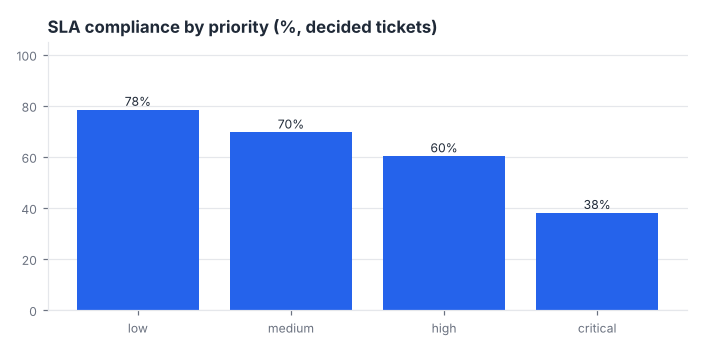
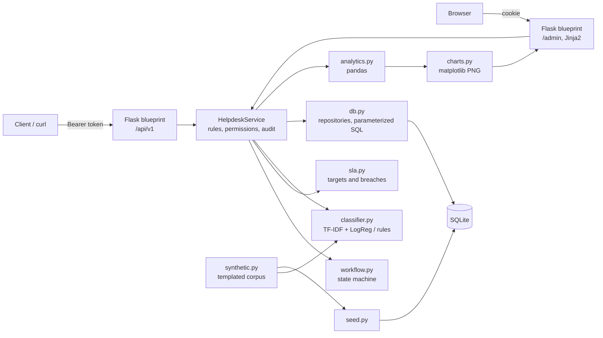
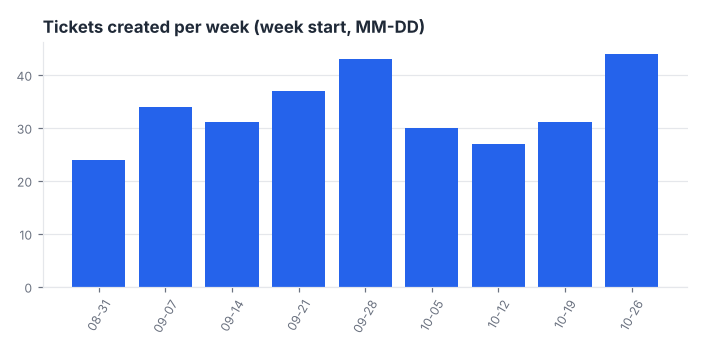
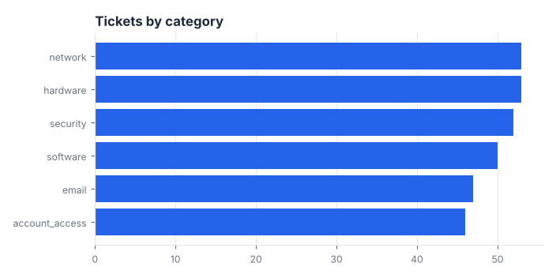
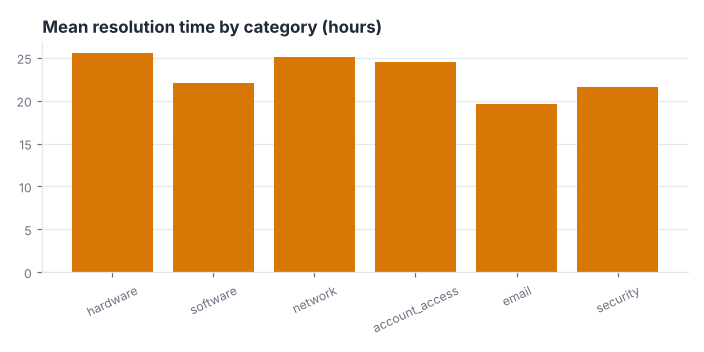
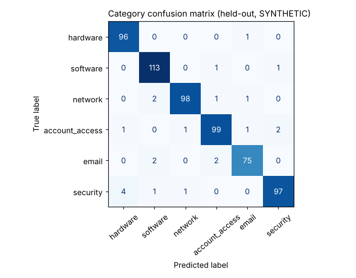

# Smart IT Helpdesk

An IT helpdesk ticketing system: Flask API and admin dashboard, a `sqlite3` repository layer, role-based
permissions, a validated ticket state machine, SLA breach detection, an audit log, and automatic ticket triage
(category and priority) with scikit-learn. Everything runs on **synthetic** demo data.

**ملخص بالعربية:** نظام تذاكر دعم فني (IT Helpdesk) مبني بـ Flask وقاعدة SQLite. يدعم الأدوار (مدير / موظف دعم / مستخدم)، ورموز مصادقة موقّعة بـ HMAC مع انتهاء صلاحية، وتشفير كلمات المرور بـ scrypt مع salt، وآلة حالات للتذاكر، ومؤشرات اتفاقية مستوى الخدمة (SLA) مع كشف التجاوزات، وسجل تدقيق، وتصنيف تلقائي للتذكرة (الفئة والأولوية) باستخدام TF-IDF مع Logistic Regression مع بديل قائم على القواعد. جميع البيانات في العرض التجريبي **اصطناعية** وليست بيانات حقيقية، والمشروع مشروع تعليمي/معرض أعمال وليس نظام إنتاج.



## Features

- **Roles and permissions:** `admin`, `agent`, `requester` with a permission table (`helpdesk/permissions.py`) plus object-level checks (requesters only see their own tickets; other users' tickets return 404).
- **Security basics (stdlib only):** scrypt password hashing with a random 16-byte salt and constant-time comparison; HMAC-SHA256 signed tokens with `exp`; role re-read from the database on every request; self-registration can only create requesters.
- **Ticket CRUD** with input validation, comments (staff-only internal notes), and an audit log of every change.
- **State machine:** `open -> in_progress -> waiting -> resolved -> closed`, with `waiting <-> in_progress` and reopen (`resolved -> in_progress`); illegal moves return HTTP 409.
- **SLA:** per-priority first-response and resolution targets (calendar minutes), `pending / met / breached` states, and a list of unresolved tickets already past a deadline.
- **Auto-triage:** TF-IDF + LogisticRegression predicts category and priority; low-confidence or missing model falls back to keyword rules. The suggestion is stored next to the final values.
- **Analytics (pandas):** volume per week, mean first-response and resolution time, SLA compliance %, breakdown by category and priority.
- **Server-rendered admin dashboard** (Jinja2, no JavaScript) with queue, SLA breaches, ticket detail and matplotlib PNG charts.
- Seed script, argparse CLI, logging, [`docs/API.md`](docs/API.md) with curl examples, 25 pytest tests using the Flask test client.

The HTTP layer is deliberately **framework-thin** (blueprints only parse and serialise; the rules live in `services.py`). FastAPI was not available in the environment this was built in, so Flask is used.

## Architecture



## Quickstart

```bash
python -m pip install -r requirements.txt   # flask, pandas, numpy, scikit-learn, matplotlib, pytest
python -m pytest -q                         # 25 tests
python scripts/demo.py                      # seed -> evaluate -> API walkthrough -> charts + sample HTML in docs/

python -m helpdesk seed --db build/demo.db  # 300 synthetic tickets, 16 demo users
python -m helpdesk train                    # writes models/classifier.joblib (synthetic training data)
python -m helpdesk serve --db build/demo.db # http://127.0.0.1:5000/admin/  (admin / demo-password-123)
```

Demo accounts (`admin`, `agent_sara`, `agent_omar`, `agent_lina`, `user01`..`user12`) are synthetic and share the password `demo-password-123`. Set `HELPDESK_SECRET_KEY` for anything beyond a local demo; the built-in development secret logs a warning.

Other CLI commands: `python -m helpdesk evaluate` (held-out accuracy as JSON) and `python -m helpdesk triage "Mailbox is full"`.

## Real output

From `python scripts/demo.py` (fixed clock, seeds 7 and 42). The demo adds one live ticket through the API, so the totals show 301 tickets.

```text
Seeded build/demo.db: users=16, tickets=300 (SYNTHETIC)

API walkthrough: ticket #301 auto-triaged -> category=security, priority=critical, source=mixed
  moved through state machine to 'closed', SLA overall = met
  closed -> open rejected with HTTP 409: Cannot move 'closed' -> 'open'. Allowed: none (terminal state)

Analytics summary (SYNTHETIC demo data):
  total_tickets: 301
  active_tickets: 6
  mean_first_response_minutes: 177.7
  mean_resolution_minutes: 1387.7
  sla_compliance_pct: 67.9
  active_breaches: 1
  SLA compliance [low     ] 78.5% over 82 tickets
  SLA compliance [medium  ] 69.6% over 140 tickets
  SLA compliance [high    ] 60.3% over 58 tickets
  SLA compliance [critical] 38.1% over 21 tickets
```

**These analytics describe the generator, not a real helpdesk.** `seed.py` simulates lifecycle times from the SLA targets with a hard-coded chance of missing each deadline (30% for critical down to 8% for low) and makes most tickets already resolved, so the compliance figures and the low active-ticket count are artefacts of those parameters.

| Chart | |
|---|---|
|  |  |
|  |  |

`docs/sample_dashboard.html` is the real admin page rendered by the app and saved as a self-contained snapshot (charts inlined).

### Classifier accuracy (synthetic, templated data)

`python -m helpdesk evaluate`: 3,000 generated tickets, 80/20 random split, 600 held-out tickets.

| Evaluation | Category | Priority |
|---|---|---|
| TF-IDF + LogisticRegression, random split | 96.3% | 79.8% |
| Keyword rules (the fallback), same test set | 80.3% | 65.2% |
| Same model, **whole templates held out** (609 test tickets, 10 templates unseen) | 32.0% | n/a |



**Read this carefully.** The corpus is generated from 48 hand-written templates with random slot values, so the same sentence patterns appear in training and test; 96.3% shows the pipeline works, **not** that it would triage real tickets that well. The 32.0% template-held-out figure is a harsher test of generalisation to unseen wording and is the more honest signal: the model largely memorises templates. About 4% of category labels and 20% of priority cue phrases are deliberately noisy, and 10% of tickets have no priority cue, which caps priority accuracy. The rule fallback has been written against the same vocabulary as the generator, so its score is optimistic as well. None of this has been measured on real tickets.

## Project structure

```text
helpdesk/
  config.py        roles, categories, SLA targets, Config
  security.py      scrypt hashing, HMAC signed tokens
  permissions.py   role -> permission table
  workflow.py      status state machine
  sla.py           SLA evaluation
  db.py            schema + repositories (parameterized SQL)
  services.py      business rules, audit, validation (framework-free)
  classifier.py    TF-IDF + LogisticRegression, rule fallback, evaluation
  synthetic.py     templated synthetic ticket generator
  analytics.py     pandas KPIs
  charts.py        matplotlib PNG charts
  seed.py          synthetic demo data
  cli.py           argparse CLI
  web/             app factory, api blueprint, dashboard blueprint, Jinja templates
tests/             25 pytest tests (Flask test client, fake clock)
scripts/demo.py    reproducible demo -> docs/
docs/              API.md, PNG charts, sample_dashboard.html
```

## Testing

```bash
python -m pytest -q    # 25 passed
```

Covers password hashing and token tampering/expiry, the permission matrix, every state-machine rule, SLA states with a controllable clock, API auth and requester isolation, ticket lifecycle and audit trail, breach detection, internal-comment visibility, validation and SQL-injection inertness, the classifier (including save/load, confidence fallback and missing-model fallback), the seed and analytics, and the dashboard (login gate, pages, PNG output). There is no coverage measurement and no load or browser testing.

## Limitations

- **Synthetic data only.** Ticket text, users, lifecycle times and all analytics are generated. No real tickets, users, or helpdesk metrics were used or measured.
- **Classifier** is trained on templated text; see the accuracy section. Expect far lower accuracy on real tickets. Models are stored with joblib (pickle): only load files you created.
- **Not production-hardened.** No rate limiting or login lockout, no CSRF token on the dashboard forms (cookie is `SameSite=Lax`), no HTTPS handling, no token revocation or refresh, runs on Flask's development server, SQLite with short-lived connections and no migrations.
- **SLA uses calendar time:** no business hours, holidays, or pausing while a ticket is `waiting`.
- No email notifications, attachments, search, pagination metadata, or UI for creating or editing tickets (the dashboard is read-only; use the API).
- Dashboard analytics read all tickets into pandas on each request, which is fine for demo volumes and not for large tables.
- The development secret is used unless `HELPDESK_SECRET_KEY` is set.

## Roadmap

- Business-hours SLA calendars and pause-on-waiting
- Evaluate triage on a real, anonymised ticket export; try character n-grams or embeddings
- CSRF tokens and a write UI in the dashboard; login throttling
- Alembic-style migrations and a PostgreSQL option
- Port the API layer to FastAPI with OpenAPI docs

## Built with AI assistance

This project was built with the help of an AI assistant (Claude). I directed the scope and reviewed the result; the code, tests, documentation and charts were produced with AI help, and every number above comes from running the code in this repository (`python -m pytest -q`, `python scripts/demo.py`, `python -m helpdesk evaluate`).

## License

MIT, see [LICENSE](LICENSE). Author: Aymen Al Erwi ([aymnb7178](https://github.com/aymnb7178)).
